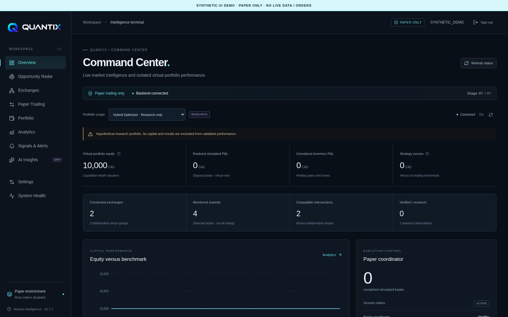
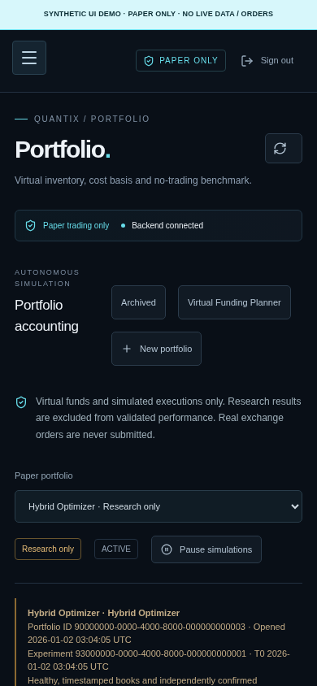
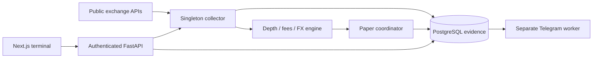

<p align="center">
  
  
</p>

<h1 align="center">QUANTIX</h1>
<p align="center">Public market intelligence. Accountable paper execution.</p>
<p align="center">
  
</p>
<p align="center">
  <a href="#capabilities">Capabilities</a> ·
  <a href="#workspace">Workspace</a> ·
  <a href="#architecture">Architecture</a> ·
  <a href="#start-locally">Start locally</a> ·
  <a href="#documentation">Documentation</a> ·
  <a href="docs/HISTORY_IMPORT.md">History disclosure</a>
</p>

QUANTIX is a self-hosted cryptocurrency research terminal. It collects public order
books, evaluates depth-aware opportunities and simulates delayed execution against
observed liquidity. Exact CAD accounting, immutable evidence and independent
portfolios make each simulated outcome inspectable.

**PAPER ONLY.** QUANTIX never submits real exchange orders. Observed spreads and
simulated results do not demonstrate real-world profitability or trading readiness.

## Review the engineering

1. [Inspect the synthetic workspace](docs/DEMO.md): the actual interface with
   disclosed fixtures, no account, exchange credentials or provider setup required
   for the documented capture path.
2. [Read the accounting case](docs/ENGINEERING_CASE_STUDY.md): exact amounts,
   independently committed execution legs, causal valuations and inspectable exports.
3. Compare [locked accounting](backend/arbiq/portfolio/accounting.py) with
   [its regression tests](tests/test_portfolio_accounting.py), then review the
   [workflow](.github/workflows/ci.yml) for the exact verification scope.

The [history disclosure](docs/HISTORY_IMPORT.md) distinguishes reconstructed import
commits from original development dates. Current source and executed checks are the
evidence; activity counts do not establish experience or simulated profitability.

## Capabilities

- **Market intelligence:** exchange discovery, canonical asset identity, bounded
  REST/native WebSocket collection, timestamp confidence and explicit stale fallbacks.
- **Quantitative research:** ask/bid depth, taker fees, executable FX, market limits,
  precision, capital constraints and reaction-delay scenarios with exact decimals.
- **Paper execution:** owned-inventory reservations, independent delayed legs,
  partial outcomes, idempotent journals and moving CAD cost basis.
- **Strategy Lab:** separate funded research/validated experiments, immutable
  strategy profiles, inventory coverage and an original-holdings benchmark.
- **Evidence and analytics:** authenticated terminal, provenance inspectors,
  CAD valuations, analytical ZIPs and complete retained-data exports.
- **Owner notifications:** private Telegram pairing, durable delivery audit,
  quiet hours and explicit ambiguous-send states. Optional AI is disabled by default.

## Workspace

Actual desktop and mobile views of the QUANTIX frontend, running against explicitly
**SYNTHETIC UI fixtures**. Every capture says **PAPER ONLY / NO LIVE DATA OR ORDERS**.
The illustrated portfolios and clock flags are fixture values; they are not recorded
financial results or a backend execution test.

<table>
  <tr>
    <td width="77%"></td>
    <td width="23%"></td>
  </tr>
</table>

[Interface walkthrough and reproducible captures](docs/DEMO.md) ·
[Engineering case: accounting and provenance](docs/ENGINEERING_CASE_STUDY.md)

The original empty-input [desktop](docs/assets/workspace-desktop.png) and
[mobile](docs/assets/workspace-mobile.png) sign-in captures remain available with
[asset provenance](docs/assets/README.md).

## Architecture



A modular Python backend, dedicated collector and PostgreSQL coordination keep the
runtime compact. Financial decisions are deterministic; AI has no authority over
scanning, risk, execution or accounting. Validated and research capital stay separate.

| Layer | Technology |
| --- | --- |
| Backend | Python 3.12+, FastAPI, Pydantic, asyncio |
| Persistence | PostgreSQL 16, SQLAlchemy 2, Alembic, NUMERIC / Decimal |
| Market data | CCXT, aiohttp, native WebSocket protocols |
| Terminal | Next.js, React, TypeScript, Tailwind CSS, Radix UI, Recharts |
| Operations | Docker Compose, NGINX/TLS tooling, bounded workers and backup/restore commands |
| Verification | pytest, Ruff, TypeScript, Playwright |

## Start locally

Use a **fresh checkout** with Docker Engine, Compose v2, Python 3 and `rg` installed.
Never point a new checkout at an existing production database or reuse an active
Telegram bot consumer.

```bash
make setup
```

For local development without a Telegram token, set
`LOCAL_NOTIFICATION_WORKER_ENABLED=false` in the generated `.env` before starting.
Configure Telegram separately through [notification setup](docs/NOTIFICATIONS.md).

```bash
make up
```

Open **http://localhost:3100**, username **quantix**. Retrieve the generated password
locally with `cat .secrets/admin-password`; keep it out of screenshots and logs.
Only the frontend publishes a loopback host port. PostgreSQL and internal APIs stay
on the private Compose network. Setup preserves an existing `.env` and secrets.

```bash
make status            # service and migration status
make frontend-install  # install the locked frontend dependencies
make test              # synthetic tests; disposable PostgreSQL test database
make down              # stop this local stack; preserve its database volume
```

The import preparation exercised fresh credential setup and validated Compose
configuration. Startup/test commands were checked against the current Makefile;
this is not a claim that a new complete Compose stack was started during import.
See [development](docs/DEVELOPMENT.md) for host tooling and browser checks.

## Research boundaries

**Implemented:** public data collection, quantitative evaluation, paper journals,
funding/Strategy Lab, authenticated analytics, exports and Telegram infrastructure.

**Conditional:** opportunity actionability requires separately verified eligibility,
funding, fee evidence, executable liquidity and trusted clock state. Public feed
access does not establish Canadian eligibility. Missing valuations remain unknown;
independent portfolio equities must never be added together.

**Planned or separately gated:** real-money execution is outside the current product;
paid notification providers and billable AI are disabled. Recurring offsite backup
and long-term unattended storage certification remain operational limitations.
See the [roadmap](docs/ROADMAP.md) and [accounting contract](docs/ACCOUNTING.md).

## Documentation

| Start here | Go deeper |
| --- | --- |
| [Development](docs/DEVELOPMENT.md) · [Contributing](CONTRIBUTING.md) · [Security](SECURITY.md) | [Architecture](docs/ARCHITECTURE.md) · [Schema](docs/SCHEMA.md) |
| [UI walkthrough](docs/DEMO.md) · [Engineering case](docs/ENGINEERING_CASE_STUDY.md) | [Financial contracts](docs/FINANCIAL_ENGINE.md) · [Accounting](docs/ACCOUNTING.md) |
| [Market data](docs/MARKET_DATA.md) · [Native feeds](docs/WEBSOCKET_ARCHITECTURE.md) | [Clock confidence](docs/CLOCK.md) · [Financial engine](docs/FINANCIAL_ENGINE.md) |
| [Terminal](docs/TERMINAL.md) · [Funding](docs/FUNDING.md) | [Accounting](docs/ACCOUNTING.md) · [Sizing](docs/SIZE_DIAGNOSTICS.md) |
| [Reporting and exports](docs/REPORTING.md) | [Telegram](docs/NOTIFICATIONS.md) · [Optional AI](docs/OPTIONAL_AI.md) |
| [Roadmap](docs/ROADMAP.md) · [Progress](PROGRESS.md) | [Deployment runbook](docs/DEPLOYMENT.md) · [Third-party attribution](docs/THIRD_PARTY.md) |

This repository uses a [disclosed reconstructed import history](docs/HISTORY_IMPORT.md).
Assigned author dates are an organizational calendar, not evidence of original work
dates or historical releases. Internal `arbiq` identifiers remain to preserve
compatibility. No new licence grant is implied; see existing third-party terms.
