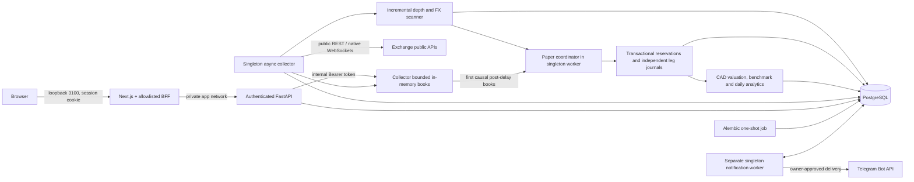

# QUANTIX architecture

A modular Python monolith, a separate public-data worker, a server-rendered frontend
and PostgreSQL fit a modest VPS without a broker/cache service. Stage 1 financial,
authentication and audit foundations are preserved. Stage 2 provides read-only market
intelligence; Stage 3 adds deterministic depth/fee/FX research and risk gates.
Stage 4 adds autonomous paper execution, immutable accounting and portfolio analytics.
Stage5 adds the complete terminal/funding/ZIP; Stage6 adds separate Telegram delivery
and optional disabled source-only explanations. Later retained changes add bounded
market profiles, executable fee/rule evidence, Strategy Lab, common-opening funding
and common-frame valuation. Operational acceptance evidence remains private.

- Collector modules own scheduling, lifecycle, public capability/market discovery,
  validated books, recovery, retention and durable provenance. Data access is read-only
  toward exchanges. CCXT's trading methods are never called and no trading keys are required by these adapters.
  Native Kraken, Coinbase Exchange and OKX protocols are implemented with bounded
  subscription selection, recovery and REST fallback; advertised third-party adapter
  capabilities do not establish implemented or healthy coverage.
- API/auth modules own opaque sessions, revocation, durable throttling and private
  data access. A cookie's mere presence never grants dashboard access. All routes,
  including market-data routes, verify sessions. BFF POST/PUT writes require matching Origin.
- market_data owns exact typed books, conservative asset identity, five-state quality,
  same-quote reference checks and anomaly evidence. AI text never enters these checks.
- finance owns deterministic Decimal primitives. opportunities owns executable depth,
  fee/FX/precision, sizing, scenario/replay, evidence lifecycle and authenticated APIs.
  paper_trading owns delayed execution and immutable evidence capture. portfolio owns
  balance locks, reservations, moving CAD basis, reconciled valuations and daily
  metrics. settings owns immutable strategy versions. Signals and full analytical
  ZIP exports preserve their explicit contracts. Strategy Lab uses separately funded
  immutable sessions and compares profiles without combining their equities.
- notifications owns a separate singleton worker, private challenge/approval, durable
  incoming offsets/outbox/events, expiry/retries/ambiguity, owner commands and Edmonton
  ordinary/emergency/report scheduling. Scanner and paper have no Telegram dependency.
  ai offers deterministic explanations and an optional strictly gated NVIDIA provider.
  External AI is disabled by default and requires explicit expiring opt-in.
  Paid push and voice providers are disabled.
- All financial scalars use NUMERIC(38,18); all internal timestamps are UTC. Unknown
  values remain explicit rather than estimated as zero or an executable quote.

PostgreSQL owns financial evidence, configuration history, user identity, collector
runs, discovery, connectivity history and selected observations. The live cache is
bounded; mutable fallback/observations/quality evidence have explicit retention.
Financial ledger and pinned snapshots remain append-only. See [SCHEMA.md](SCHEMA.md) and
[MARKET_DATA.md](MARKET_DATA.md) for the persistence boundary.

Migrations run as a separate health-gated one-shot service; no ORM create_all runs
in deployment. Backend and collector require the exact expected schema revision.
The collector owns a session advisory lock held on a dedicated connection, without
an idle transaction; loss of ownership/persistence causes a safe process restart.
Network failures remain isolated per exchange with REST/stream recovery and backoff.
The authenticated API/dashboard remain operational during a collector outage and
label persisted fallback data explicitly.

Local Compose publishes only 127.0.0.1:3100. PostgreSQL, backend and collector are
internal. Application containers run non-root with capabilities dropped. Tokens,
passwords and environment files are excluded from Git/build contexts and logs.
Local HTTP uses SameSite=Strict HttpOnly cookies with COOKIE_SECURE=false.
Any public deployment requires TLS, secure cookies, least-privilege database roles,
backup/restore verification and measured resource budgets. No deployment is
authorized merely by importing this repository.

Internal arbiq package, database and Compose names are retained to avoid data loss.
The official product identity is QUANTIX, using the supplied PNG assets.

Stage 3 clock, coverage, calculation and persistence boundaries are detailed in
[ARBITRAGE.md](ARBITRAGE.md), [FINANCIAL_ENGINE.md](FINANCIAL_ENGINE.md) and [CLOCK.md](CLOCK.md).
Stage 4 execution timing, financial recognition, scenario isolation and worker crash
recovery are specified in [ACCOUNTING.md](ACCOUNTING.md). Paper execution stays within the
singleton collector; Telegram has a separate singleton consumer. No Redis or broker
is needed.
