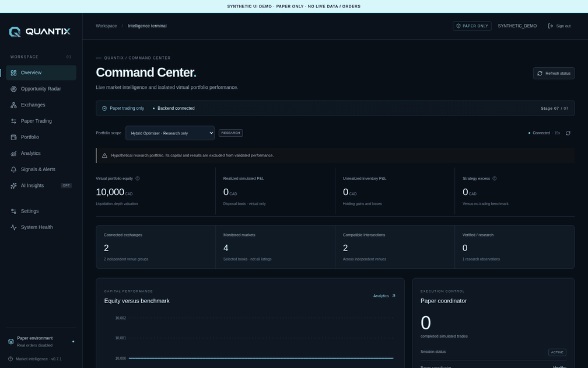
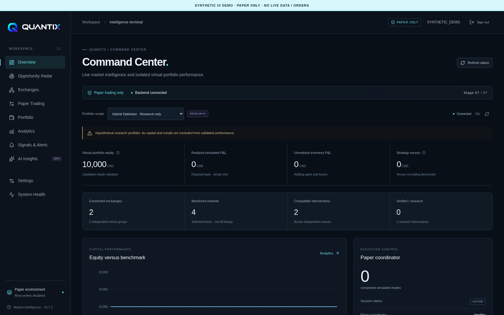
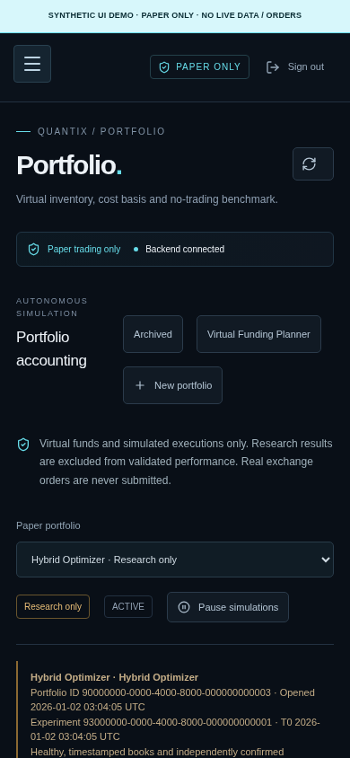

# Explore the QUANTIX interface

These images show the **actual QUANTIX frontend** with explicitly **SYNTHETIC UI
contract fixtures**. Every image and animation carries a persistent **PAPER ONLY /
NO LIVE DATA OR ORDERS** ribbon. No owner account, production database, private
portfolio, live exchange feed or Telegram consumer was used.

[Engineering case](ENGINEERING_CASE_STUDY.md) · [Development guide](DEVELOPMENT.md) ·
[Accounting semantics](ACCOUNTING.md)

## A short interface walkthrough



The animation is assembled from sequential browser frames of the unchanged source
interface: Command Center → Portfolio → Hold Control → Archived → Strategy Lab →
a comparison with an explicitly unavailable valuation. It is an interaction
walkthrough, not a performance backtest or financial-engine run.

## Workspace views

<table>
  <tr>
    <td width="77%"></td>
    <td width="23%"></td>
  </tr>
</table>

| View | What to inspect |
| --- | --- |
| [Portfolio](assets/showcase/portfolio-desktop.png) | Independent research scope, separate initial/current equity and zero simulated P&L |
| [Strategy Lab](assets/showcase/strategy-lab-desktop.png) | Shared opening evidence, independent starting capital and the passive Hold profile |
| [Comparison](assets/showcase/comparison-desktop.png) | Missing valuation fields remain unavailable; portfolio equities are not aggregated |

The original [empty-input desktop](assets/workspace-desktop.png) and
[mobile](assets/workspace-mobile.png) sign-in captures remain actual unauthenticated
local views. They do not demonstrate successful authentication.

## What is synthetic—and what is real

The rendered components, navigation, selectors, responsive layout and formatting
come from the public frontend source. The banner is a capture-only browser overlay;
it adds disclosure without changing product source or financial logic.

The API transport, user identity, four research portfolios, timestamps, starting
holdings, clock flags and comparison response are synthetic. Their shapes follow
existing [terminal](../frontend/e2e/terminal.spec.ts) and
[Strategy Lab](../frontend/e2e/strategy-lab.spec.ts) regression fixtures. A curated
zero-result opening keeps the illustrative holdings at exactly CAD 10,000 per
independent portfolio; no successful fill or positive profit is invented.

One comparison row deliberately has a missing closing valuation. The existing UI's
"recorded/forward paper" vocabulary is visible because these are its real response
components; the marked responses here are **not actual recorded forward results**.
Displayed reconciliation and confidence fields are fixture values, not independently
verified ledger or clock measurements. Fixed January 2026 source timestamps remain
visible and are not presented as current market observations.

This capture does not execute the financial engine, prove owner eligibility, place
an exchange order, post a journal, create a funded session or test live notification
delivery. The application source has separate numerical/database/browser validation;
see [the engineering case](ENGINEERING_CASE_STUDY.md#operational-shape-and-verification).

## Reproduce locally

Use a **fresh isolated clone**, without `.env`, `.secrets` or `.local`. The script
refuses such private state and binds only two unprivileged loopback ports. It rejects
mutating fixture API operations; the sole supported POST is the read-only comparison.
No credentials or external provider configuration are required.

```bash
cd frontend
npm ci
npm run build
npx playwright install chromium
cd ..
node scripts/capture-showcase.mjs
```

The script starts its own fixture transport and production-mode frontend on
`127.0.0.1:3372` and `127.0.0.1:3371`, captures desktop/mobile views, blocks off-origin
browser requests, and closes its browser and child server on completion or error.
An occupied port fails without stopping the process that owns it. Set
`PLAYWRIGHT_CHROMIUM_EXECUTABLE` only when intentionally selecting an already
installed compatible Chromium executable.

Optional parameters:

```bash
node scripts/capture-showcase.mjs --port 3471 --fixture-port 3472 --output /tmp/quantix-showcase
```

To encode the captured frames as the GIF above, install Pillow in a separate local
virtual environment and run:

```bash
python3 -m venv /tmp/quantix-showcase-tools
/tmp/quantix-showcase-tools/bin/python -m pip install Pillow
/tmp/quantix-showcase-tools/bin/python scripts/build-showcase-gif.py \
  docs/assets/showcase/.frames docs/assets/showcase/workspace-walkthrough.gif
```

PNG frames retain the whole viewport and disclosure ribbon; GIF encoding only fits
and quantizes those captured frames. Raw `.frames/` are ignored. The sanitized
[capture report](assets/showcase/capture-report.json) records dimensions, fixture
hash, API paths, errors and blocked external origins. It contains no password,
private environment dump or production operational evidence.

The committed capture set was made from public snapshot
`157fb407f8fc1bce9762ef7f93d5c3b4fb03d1c6`. A byte-identical existing production build
was reused locally to avoid a redundant build during an unrelated active research
run. The demonstrated source/payloads do not change financial decisions or the
collector's cadence.
