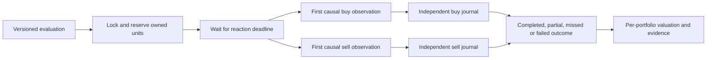

# QUANTIX: making a paper outcome reconstructable

QUANTIX is a self-hosted cryptocurrency research terminal. Public order books feed
an exact numerical engine, delayed paper execution and auditable CAD accounting.
It submits **no real exchange orders**. A displayed spread is an observation;
a simulated outcome is a separate financial record.

This case describes decisions visible in the accepted source, with links to their
implementation and existing regressions. It does not assert profitable live trading,
production readiness in every environment or original development dates. Source
chronology and attribution remain in [the import disclosure](HISTORY_IMPORT.md).

[Actual UI walkthrough](DEMO.md) · [Architecture](ARCHITECTURE.md) ·
[Accounting](ACCOUNTING.md) · [Financial engine](FINANCIAL_ENGINE.md)

## The engineering problem

An attractive spread can disappear after depth, taker fees, conversion, order limits
and reaction delay. Even an admissible paper candidate can have only one leg fill.
A portfolio can also hold assets for which a current CAD mark is unavailable.
Reporting a single profit number would hide those distinctions.

The implementation therefore keeps four questions separate:

| Question | Durable evidence |
| --- | --- |
| What was observed? | Timestamped source books, identity, fee/rule versions and clock confidence |
| What was estimated? | Immutable route evaluation, sizing, executable FX and explicit assumptions |
| What happened in paper execution? | Reservations, delayed observations, independent leg outcomes and events |
| How is the portfolio valued? | Per-asset units and basis, causal liquidation marks, original-holdings benchmark and missing-value reasons |

## Decision 1: make the numerical boundary explicit

Prices, money, rates and quantities enter through exact decimal validation. Python
`Decimal` calculations and PostgreSQL `NUMERIC(38,18)` storage remain authoritative;
browser chart coordinates are display values. The execution calculation consumes
asks to acquire and bids to dispose, follows actual depth and applies market rules
and fee denomination. USD, CAD, USDC and USDT do not acquire parity by sharing a role
as quote currencies.

The conservative direction matters: derived quantities are floored to their permitted
grid, while acquisition debits and explicit fees must still fit the owned reservation.
Missing fees or conversion evidence do not become free execution.

- Implementation: [validation](../backend/arbiq/finance/contracts.py),
  [depth/FX/sizing](../backend/arbiq/opportunities/math.py),
  [paper leg calculation](../backend/arbiq/paper_trading/execution.py).
- Existing regressions: [arbitrage arithmetic](../tests/test_arbitrage_math.py),
  [rounding, limits and slippage](../tests/test_paper_execution.py),
  [native rule provenance](../tests/test_native_trading_rules.py).
- Tradeoff: exact validation and conservative boundaries can reject a visually
  promising route. A rejected estimate is preferable to invented executable liquidity.

## Decision 2: model independent legs rather than atomic success

The paper coordinator owns simulation; the scanner only projects scenarios. A
session lock and idempotency identity precede inventory reservation. Each exchange
leg commits independently with immutable journal and evidence records. A successful
buy followed by a missing sell observation leaves explicit exposure and a partial
outcome, rather than a completed arbitrage profit.

Ledger entries are append-only. Restart identities and pinned observations let the
worker resume without duplicating already recorded balances. Weighted-average CAD
basis, matched-leg cashflows and holding gains are distinct measures. Disclosed fees
must not be subtracted again from cashflows that already contain them.

- Implementation: [coordinator](../backend/arbiq/paper_trading/coordinator.py),
  [locked accounting and journals](../backend/arbiq/portfolio/accounting.py),
  [ledger models](../backend/arbiq/db/models.py).
- Existing regressions: [reservations and reconciliation](../tests/test_portfolio_accounting.py),
  [independent legs, timeouts and restart](../tests/test_paper_execution.py).
- Tradeoff: the model exposes unmatched inventory and failure states. It does not
  promise the atomicity that two independent exchange legs cannot guarantee.

## Decision 3: preserve time uncertainty and unavailable values

The application does not repair the host clock. Independently corroborated UTC is
projected with monotonic elapsed time, uncertainty and expiry. Financial decisions
must check that trust is still valid. Original source and ingestion times remain
part of the evidence; replay cannot use a future book or FX path.

Valuation follows the same rule. A missing causal conversion, expired observation
or insufficient liquidation depth can make a total unavailable. A known partial
subtotal is useful, but it does not become a complete equity figure by treating
unpriced holdings as zero. Shared Strategy Lab portfolios receive a common price
and FX frame while retaining their own capital and original-holdings benchmarks.

- Implementation: [trusted clock](../backend/arbiq/core/clock.py),
  [causal marks](../backend/arbiq/paper_trading/market.py),
  [valuation](../backend/arbiq/portfolio/valuation.py).
- Existing regressions: [clock confidence](../tests/test_clock.py),
  [unknown totals and benchmark depth](../tests/test_portfolio_accounting.py),
  [shared-frame marks](../tests/test_paper_marks.py).
- Tradeoff: fail-closed trust and nullable totals reduce the amount of apparently
  complete data. They preserve the difference between evidence and an assumption.

## Decision 4: make reporting useful outside the application

Exports carry exact strings, source references and explicit availability states.
The complete retained-data contract is `quantix-full-v2`; the custom analytical
contract remains `quantix-export-v1`. Independent portfolio equities are never
summed into one performance result.

Typed JSON DAG deduplication reduces repeated payloads without pruning PostgreSQL
financial history. A standalone loader and semantic hashes make decoded evidence
inspectable. If a bounded analysis fallback is needed, reductions and coverage must
be disclosed. Final ZIP publication checks the closed archive's size and integrity;
the cap remains **512,000,000 decimal bytes**.

- Implementation: [full export](../backend/arbiq/analytics/full_export.py),
  [publication budget](../backend/arbiq/analytics/export_budget.py),
  [standalone loader](../backend/arbiq/analytics/export_loader.py).
- Existing regressions: [full scope/privacy](../tests/test_full_export.py),
  [budget, cancellation and semantic reconstruction](../tests/test_export_budget.py).
- Tradeoff: preserving source evidence costs disk, CPU and generation time. The
  system reports limits explicitly instead of quietly truncating financial rows.

## Operational shape and verification

A modular FastAPI application, one collector, PostgreSQL coordination and Next.js
fit the project's self-hosted scope. The collector owns bounded live caches and the
paper coordinator; Telegram delivery has a separate worker. AI is optional,
disabled by default and has no quantitative authority. No message broker is required
for the core market/accounting path.

At public source snapshot `157fb407`, [GitHub Actions run 45523746677](https://github.com/rcc00n/QUANTIX/actions/runs/45523746677)
recorded **883 backend tests**, TypeScript/production build, core stack startup and
**25 browser tests** passing. Five opt-in live checks were skipped. These are actual
verification results from 2026-11-25 UTC, not tests claimed on reconstructed author
dates. They do not establish live-market profitability or live Telegram delivery.

The [showcase](DEMO.md) is an additional rendering check. Its browser-only synthetic
contract responses do not execute the financial engine or validate a database ledger.

## Boundaries that remain deliberate

- Public feed access does not establish owner eligibility, funding or actionability.
- A book snapshot is not a guarantee of future executable liquidity.
- Research and validated capital, outcomes and benchmarks remain separate.
- Real-money execution, paid notification providers and billable AI are not enabled.
- Multi-day unattended storage capacity and recurring offsite recovery require their
  own operational evidence; an import or passing CI is not that certification.

The reusable lesson is to make uncertainty, ownership and provenance part of the
model, so every displayed financial conclusion can be traced to the evidence that
was available when the decision was made.
