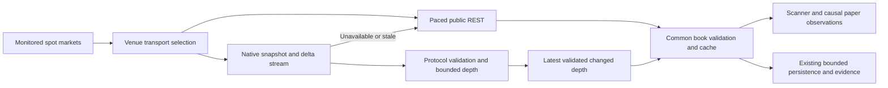

# QUANTIX market data transport

Stage 8C adds bounded public spot WebSocket depth for Coinbase Exchange and OKX alongside the existing Kraken v2 feed. The singleton collector owns market discovery, REST scheduling and normalized depth evidence. This release is a local candidate. See [PROGRESS.md](../PROGRESS.md) for deployment status.

## Market selection

The collector allocates monitored spot markets before choosing transport. Coinbase Exchange and OKX each get up to two native priority markets by default, with a configuration limit of four per venue. A market needs verified base and quote identities, active status and a compatible market on another liquidity venue. A venue takes at most one native market per canonical base asset. Coinbase Exchange prefers BTC then ETH under the default priority order. OKX gives SOL and XRP first consideration. Actual products depend on the monitored set and quote compatibility. Kraken retains its existing subscription behavior over its monitored selection.

Coinbase Advanced and Coinbase Exchange count as one liquidity venue. The new Coinbase connector uses Exchange product IDs associated with `coinbaseexchange`. The selector preserves exact pairs, including separate USD, CAD, USDC and USDT markets.

The Exchanges tiers describe collection priority. `FAST_LANE` includes the selected native slots and Kraken markets with recorded stream activity. Other priorities and active markets with at least 1,000,000 units of native quote volume appear as `STANDARD`. Remaining markets appear as `RESEARCH`. Book confidence and execution eligibility are separate.

