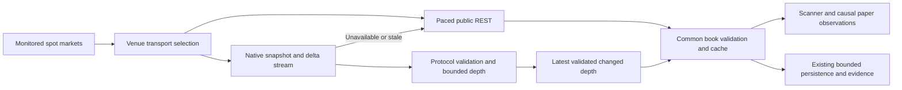

# QUANTIX market data transport

Stage 8C adds bounded public spot WebSocket depth for Coinbase Exchange and OKX alongside the existing Kraken v2 feed. The singleton collector owns market discovery, REST scheduling and normalized depth evidence. This release is a local candidate. See [PROGRESS.md](../PROGRESS.md) for deployment status.

## Market selection

The collector allocates monitored spot markets before choosing transport. Coinbase Exchange and OKX each get up to two native priority markets by default, with a configuration limit of four per venue. A market needs verified base and quote identities, active status and a compatible market on another liquidity venue. A venue takes at most one native market per canonical base asset. Coinbase Exchange prefers BTC then ETH under the default priority order. OKX gives SOL and XRP first consideration. Actual products depend on the monitored set and quote compatibility. Kraken retains its existing subscription behavior over its monitored selection.

Coinbase Advanced and Coinbase Exchange count as one liquidity venue. The new Coinbase connector uses Exchange product IDs associated with `coinbaseexchange`. The selector preserves exact pairs, including separate USD, CAD, USDC and USDT markets.

The Exchanges tiers describe collection priority. `FAST_LANE` includes the selected native slots and Kraken markets with recorded stream activity. Other priorities and active markets with at least 1,000,000 units of native quote volume appear as `STANDARD`. Remaining markets appear as `RESEARCH`. Book confidence and execution eligibility are separate.

## Protocols

| Adapter | Public feed | QUANTIX integrity checks |
| --- | --- | --- |
| Kraken | `wss://ws.kraken.com/v2`, `book` | Request a snapshot and the nearest supported depth at or above configured depth. Apply level updates and check CRC32 over the top ten levels per side. |
| Coinbase Exchange | `wss://ws-feed.exchange.coinbase.com`, `level2_batch` and `heartbeat` | Check requested product subscriptions, start from native snapshots, apply absolute level sizes and reject invalid prices, shapes and regressed book event times. |
| OKX | `wss://ws.okx.com/ws/v5/public`, spot `books` | Start from a native snapshot, then verify each incremental packet's `prevSeqId` links to the last accepted `seqId`. |

Kraken applies all changes before computing CRC32 and keeps exact Decimal price and size representations. A zero quantity removes a level. CRC32 covers the top ten levels even when subscribing at greater depth. The protocol has no contiguous sequence to enforce. [Kraken v2 depth](https://docs.kraken.com/exchange/api-reference/spot-websocket-v2/book), [Kraken checksum guide](https://docs.kraken.com/exchange/guides/websockets/book-checksum-v2).

Coinbase's public Exchange channel groups Level 2 changes in nominal 50 ms batches. Snapshots have receipt time and leave exchange event time unset. A batch timestamp identifies the latest represented event. Zero size removes a level. The batch has no per-book checksum or sequence field. Product heartbeat sequences are not batch-frame continuity evidence and cannot renew quote timestamps. [Coinbase Exchange channels](https://docs.cdp.coinbase.com/exchange/websocket-feed/channels).

Coinbase retains a known price region of at most `max(256, 4 × depth)` levels per side. A deletion that exhausts the known region needed to publish the configured depth forces a fresh snapshot. The client does not infer depth from the discarded tail. The parser caps an individual snapshot side at 100,000 received levels and an update batch at 8,192 changes, subject to the message size limit.

OKX `books` begins with up to 400 levels per side and sends incremental changes at a nominal 100 ms interval when the book changes. The client retains bounded channel depth and projects the configured depth. `seqId` may advance by more than one if the predecessor links. An exact duplicate or linked empty heartbeat contributes liveness only. A reset, bad predecessor, contradictory sequence, maintenance notice or timestamp regression requires new snapshots. OKX deprecated the checksum field in this JSON channel in June 2026. A missing field or integer zero is accepted. Any other value quarantines the stream. [OKX order-book channel](https://www.okx.com/docs-v5/en/#order-book-trading-market-data-ws-order-book-channel), [OKX checksum deprecation](https://www.okx.com/docs-v5/log_en/#2026-06-23).

## Limits, recovery and fallback

One native connection per enabled venue lives in the singleton collector. A single subscription message requests the selected products. A changed selection retires the old connection. Reconnect starts from new snapshots and clears pending previous-generation updates. The default retry policy starts at two seconds with jitter and backs off up to 300 seconds.

| Client bound | Coinbase Exchange and OKX | Kraken |
| --- | --- | --- |
| Incoming message size | 2 MiB | 2 MiB |
| Receive queue high-water mark | 8 | 16 |
| Open / close timeout | 12 / 3 seconds | 15 / 5 seconds |
| WebSocket control ping / timeout | 20 / 10 seconds | 20 / 10 seconds |
| Snapshot deadline | 15 seconds by default | Existing receive-idle timeout |
| Inactivity deadline | 45 seconds by default | 45 seconds by default |
| Publication interval | One second by default | One second by default |

OKX also sends the venue text `ping` every 20 seconds and requires `pong` within 10 seconds. Coinbase publishes subscription and inbound-message limits. QUANTIX batches both channels and selected products in one request. OKX documents three connection attempts per second per IP and 480 subscribe, unsubscribe or login requests per connection per hour. Its parser accepts at most 29 spot instruments, and collector selection uses the smaller four-market cap. The selected feeds use public endpoints without login or paid depth. [Coinbase WebSocket limits](https://docs.cdp.coinbase.com/exchange/websocket-feed/rate-limits), [OKX WebSocket limits](https://www.okx.com/docs-v5/en/#overview-websocket).

The Coinbase Exchange and OKX clients validate each protocol frame before publication coalescing. The client keeps one latest pending changed projection per product. Equal projected depth does not create another observation. A later changed projection can replace a waiting one within the publication interval. The accepted projection retains actual frame receipt UTC and exchange event time when supplied. Monotonic timing measures local work, queue delay and deadlines.

Disconnect, desynchronization or selection retirement marks affected Coinbase Exchange and OKX cache entries stale and clears the subscription's live acceptance state. Eligible markets return to REST under existing pacing and venue cooldowns. A native observation suppresses ordinary REST only while the stream is synchronized and recently active and the cached depth has a trusted clock, usable source time and acceptable quality. Its older source or receipt age must be below the smaller of the diagnostic stale threshold and half the maximum book age. The default bound is 30 seconds. Anomaly confirmation uses paced REST. A late ordinary REST response yields to qualified stream evidence received since the request began.

A responsive connection can still carry an old quote. Heartbeat and pong activity leave the quote timestamps intact. Untrusted time, invalid or expired quotes and poor synchronization return scheduling to REST when available. Retained observations preserve their actual transport and time. [Timestamp contract](MARKET_DATA_TIMESTAMPS.md).

